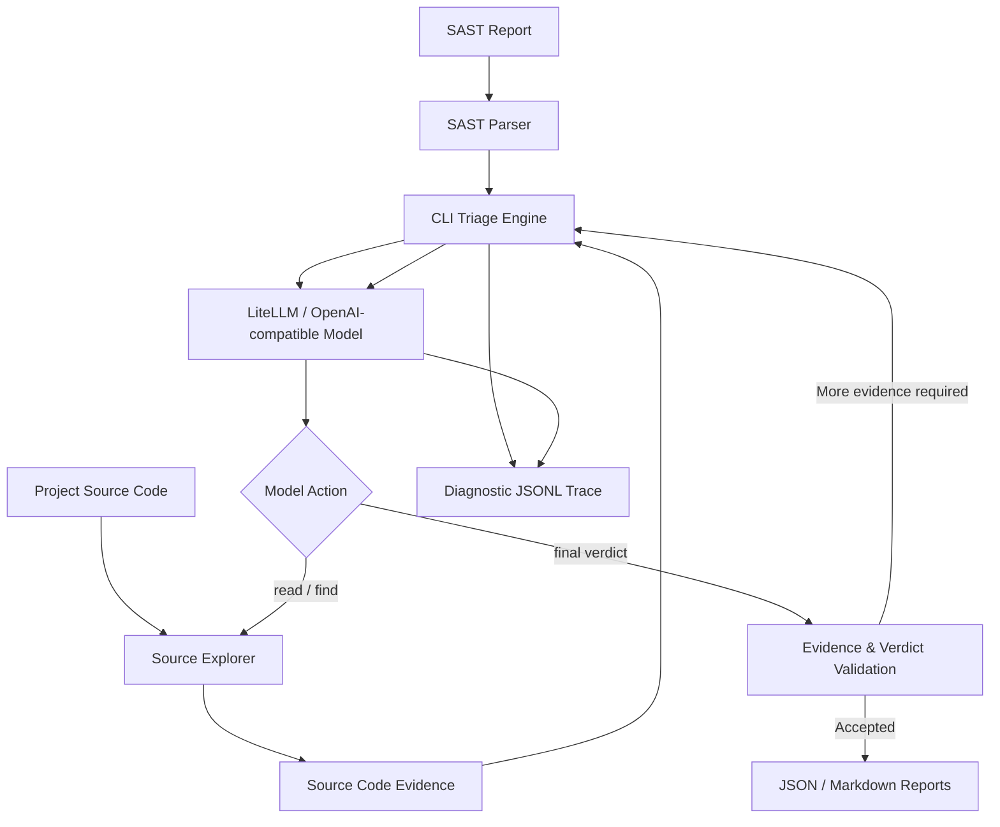

# LiteLLM SAST Triage

LiteLLM SAST Triage is a CLI tool that uses AI to analyze SAST findings and reduce the time spent on manual vulnerability triage.

The tool lets AI investigate the code behind each alert, trace data from its source to a potential vulnerability, and explain whether the finding is a true or false positive.

The result is a ready-to-review report containing the original SAST finding, AI verdict, explanation, and relevant source code blocks. Security engineers can verify the analysis directly in the report without spending extra time searching through the repository.

## Quick Start

### 1. Installation

**macOS / Linux**

```bash
git clone https://github.com/eZer-Net/litellm-sast-triage.git
cd litellm-sast-triage
cp .env.example .env
```

Edit `.env` and configure your LiteLLM or OpenAI-compatible endpoint:

```ini
AI_BASE_URL=https://llm.example.com/v1/chat/completions
AI_API_KEY=YOUR_API_KEY
AI_MODEL=your-model-id
```

Requires Python 3.10+. No additional Python packages are required.

### 2. Run

**Interactive mode**

```bash
python3 agent.py
```

**Analyze a project**

```bash
python3 agent.py --project /path/to/project
```

**Custom SAST file and report name**

```bash
python3 agent.py --project /path/to/project --scan scan-all.json --resultName security-review
```

### CLI Options

| Option | Description | Required |
|---|---|---|
| `--project PATH` | Path to the project source code | Yes, unless set in `.env` or entered interactively |
| `--scan FILE` | SAST results file, relative to the project directory | No |
| `--resultName NAME` | Custom name for the generated reports | No |
| `--start ID` | First finding to analyze | No |
| `--end ID` | Last finding to analyze | No |

CLI arguments take priority over `.env` settings.

By default, reports use a timestamped name to avoid overwriting previous results:

```text
triage-result-ai-13.10.2026-09-14-30
```

## How It Works



The agent starts from the exact location reported by the SAST scanner. The AI can request related code, follow function calls, inspect data transformations, and check whether untrusted input reaches a vulnerable sink.

The CLI manages source code access, caches previously inspected blocks, and checks whether the AI verdict is supported by the collected evidence.

## Example Triage Report

Each Markdown report contains the original SAST finding, the AI verdict, and the source code used during the analysis.

<details open>
<summary><strong>Example: Alert 7 — SQL Injection (TP)</strong></summary>

### Semgrep

| Field | Value |
|---|---|
| Rule | `javascript.lang.security.audit.sqli` |
| CWE | CWE-89 — SQL Injection |
| File | `src/database/users.js` |
| Location | `24:5–24:48` |
| Message | Possible SQL injection through a dynamically constructed query |

### AI Triage

| Field | Value |
|---|---|
| Verdict | **TP** |
| Source | `src/api/users.js:12` |
| Sink | `src/database/users.js:24` |
| Sanitizer | None found in the traced path |
| Evidence quality | Provided |

### AI Explanation

The `userId` value comes from an HTTP request parameter and is passed to `getUser()` without validation. The database function inserts this value directly into a SQL statement before executing it. No parameterized query or effective sanitization is present in the inspected path.

### Taint Flow / Source Code Evidence

**Step 1 — Source: HTTP request parameter**

`src/api/users.js:10–14`

```javascript
router.get('/users/:id', async (req, res) => {
  const userId = req.params.id;
  const user = await getUser(userId);
  res.json(user);
});
```

**Step 2 — Propagation: Function argument**

`src/database/users.js:21–24`

```javascript
export async function getUser(userId) {
  const query = `SELECT * FROM users WHERE id = '${userId}'`;
  return database.query(query);
}
```

**Step 3 — Sink: SQL execution**

`src/database/users.js:23–24`

```javascript
const query = `SELECT * FROM users WHERE id = '${userId}'`;
return database.query(query);
```

**Conclusion:** TP — external input reaches a dynamically constructed SQL query without effective protection.

</details>

*This is an illustrative example, not a finding from an actual scan.*

### Why This Report Is Useful

- **Original SAST finding** — preserves the vulnerability name, file path, location, and scanner description.
- **AI verdict and explanation** — shows the TP/FP status and why the model reached that conclusion.
- **Taint-flow evidence** — traces how data moves from its source through the relevant code to the sink.
- **Source code blocks** — includes the code inspected by the AI, with file paths and line numbers.
- **Faster manual review** — lets an AppSec engineer check the verdict without manually searching for every related function.

The goal is simple: **spend less time collecting code and more time verifying security findings.**

The AI provides an initial assessment and the evidence behind it. The security engineer reviews that evidence and confirms whether the finding requires remediation.

## Output Files

Each run generates a matching set of files in the `output/` directory:

```text
output/
├── triage-result-ai-13.10.2026-09-14-30.json
├── triage-result-ai-13.10.2026-09-14-30.md
└── triage-result-ai-13.10.2026-09-14-30.trace.jsonl
```

| File | Purpose |
|---|---|
| JSON | SAST findings, AI verdicts, and collected evidence |
| Markdown | Human-readable triage report with source code blocks |
| Trace JSONL | Model requests, responses, parsing errors, and tool actions |

## Documentation

Technical documentation is available in English and Russian.

### English

| Guide | Description |
|---|---|
| [Overview](docs/en/overview.md) | Installation, analysis workflow and results |
| [Architecture](docs/en/architecture.md) | Project structure, modules and extension points |
| [Configuration](docs/en/configuration.md) | Environment variables and their purpose |
| [Triage Capabilities](docs/en/capabilities.md) | Caching, source exploration and evidence validation |
| [SAST Parser](docs/en/sast-parser.md) | Required fields and integration with other scanners |
| [LLM Integration](docs/en/llm-integration.md) | Request handling, responses and flexible command parsing |
| [Diagnostics](docs/en/diagnostics.md) | JSONL tracing and troubleshooting |

### Русский

| Руководство | Описание |
|---|---|
| [Обзор](docs/ru/overview.md) | Запуск, этапы анализа и результаты |
| [Архитектура](docs/ru/architecture.md) | Дерево проекта, модули и точки расширения |
| [Конфигурация](docs/ru/configuration.md) | Все параметры окружения и назначение |
| [Возможности триажа](docs/ru/capabilities.md) | Кеширование, поиск и проверка доказательств |
| [Парсер SAST](docs/ru/sast-parser.md) | Обязательные поля и подключение сканеров |
| [Интеграция LLM](docs/ru/llm-integration.md) | Запросы, ответы и гибкий парсер команд |
| [Диагностика](docs/ru/diagnostics.md) | Журнал JSONL и поиск ошибок |

## License

This project is licensed under the [MIT License](LICENSE).
