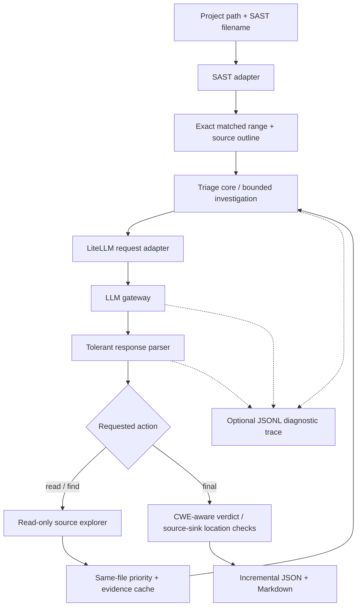

# LiteLLM SAST Triage overview

## Overview

Provide an existing source repository and its SAST result file. The CLI reviews each finding, supplies exact matched code, lets the LLM request `read` / `find`, checks whether claimed source/sink locations were actually observed, and writes reviewable results. No `workspace/` layout is required and project code is never executed.

## Quick start

```bash
bash install.sh
# Edit .env: AI_BASE_URL, AI_API_KEY, AI_MODEL
python3 agent.py --project /absolute/path/to/repository --scan scan-all.json
```

`scan-all.json` is read from the selected project directory. A relative project path is resolved from the terminal's current directory. Alternatively, set `PROJECT_DIR` and `SCAN_FILE` in `.env`; omitting the project flag prompts for a path in an interactive terminal if `PROJECT_DIR` is empty. **Flags take precedence over `.env`.**

```bash
python3 agent.py --project ./my-app --scan reports/semgrep.json --resultName security-review --start 1 --end 20
```

**Docker:** `PROJECT_MOUNT=/absolute/path/to/repository docker compose run --build --rm triage --project /app/target --scan scan-all.json`. Set `PROJECT_MOUNT` to the host directory you want to scan. Mount is read-only. Configure `.env` first.

## How the CLI works



## Outputs

| File | Contents |
|---|---|
| `output/<name>.json` | Normalized SAST finding, AI verdict, comments and observed evidence |
| `output/<name>.md` | Human-readable reasoning and actual source excerpts with line ranges |
| `output/<name>.trace.jsonl` | Optional detailed model requests, responses, parse errors and tool actions |

A `TP` is a model-assisted assessment, not automatically a verified exploit. See [Evidence controls](docs/en/capabilities.md) and [Diagnostics](docs/en/diagnostics.md).

## Documentation

| Topic | Guide |
|---|---|
| Architecture and source tree | [Architecture](docs/en/architecture.md) |
| **Every** `.env` variable | [Configuration](docs/en/configuration.md) |
| Source investigation, cache and safeguards | [Triage capabilities](docs/en/capabilities.md) |
| Changing scanner parsing / required fields | [SAST parser](docs/en/sast-parser.md) |
| LiteLLM requests, responses and tolerant parser | [LLM integration](docs/en/llm-integration.md) |
| Request trace and troubleshooting | [Diagnostics](docs/en/diagnostics.md) |

**Tests:** `PYTHONPATH=src python3 -m unittest discover -s tests -v`
