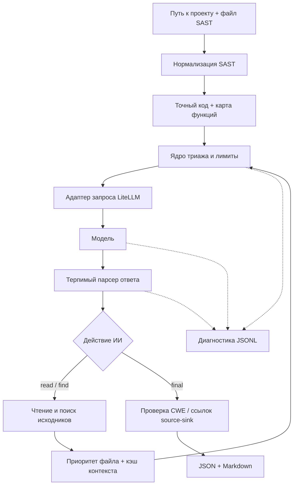

# Обзор LiteLLM SAST Triage

## О проекте

CLI выполняет триаж существующих SAST-находок с помощью модели через LiteLLM: показывает точный код срабатывания, даёт модели безопасные инструменты `read` / `find`, проверяет координаты указанных source/sink и формирует аудируемый отчёт. Исходники проекта не исполняются. **Специальная директория `workspace/` не нужна.**

## Быстрый старт

```bash
bash install.sh
# Заполнить AI_BASE_URL, AI_API_KEY, AI_MODEL в .env
python3 agent.py --project /absolute/path/to/repository --scan scan-all.json
```

`scan-all.json` ищется **внутри указанного проекта**. Относительный путь к проекту считается от текущей директории терминала. Вместо флагов можно использовать `PROJECT_DIR` и `SCAN_FILE` в `.env`. Если путь не задан, интерактивный CLI запросит его. **Флаги имеют приоритет над `.env`.**

```bash
python3 agent.py --project ./my-app --scan reports/semgrep.json --resultName security-review --start 1 --end 20
```

**Docker:** `PROJECT_MOUNT=/absolute/path/to/repository docker compose run --build --rm triage --project /app/target --scan scan-all.json`. Выбранная папка подключается только для чтения.

## Как проходит триаж



## Итоговые файлы

| Файл | Содержимое |
|---|---|
| `output/<name>.json` | Исходный алерт, AI TP/FP/NEEDS_REVIEW/UNKNOWN и доказательства |
| `output/<name>.md` | Читаемые комментарии и фрагменты кода с координатами |
| `output/<name>.trace.jsonl` | Необязательный журнал запросов ИИ, ответов и работы инструментов |

Проверка координат не равна формальному доказательству уязвимости. См. [Механизмы проверки](docs/ru/capabilities.md) и [Диагностика](docs/ru/diagnostics.md).

## Документация для разработки

| Тема | Руководство |
|---|---|
| Архитектура и дерево исходников | [Архитектура](docs/ru/architecture.md) |
| **Все** переменные `.env` | [Конфигурация](docs/ru/configuration.md) |
| Кэш, `read`/`find`, ограничения и доказательства | [Возможности ядра](docs/ru/capabilities.md) |
| Как заменить SAST-парсер и обязательные поля | [Парсер SAST](docs/ru/sast-parser.md) |
| Изменение запросов, ответов и парсера LiteLLM | [Интеграция LLM](docs/ru/llm-integration.md) |
| Разбор ошибок и trace JSONL | [Диагностика](docs/ru/diagnostics.md) |

**Тесты:** `PYTHONPATH=src python3 -m unittest discover -s tests -v`
